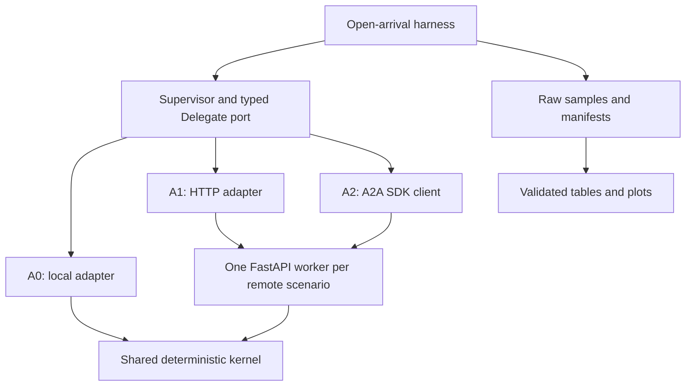

# Agent Boundary Bench

A reproducible laboratory asking: **what changes when the same specialist call crosses a process and protocol boundary?** Synthetic corporate credit analysis runs through in-process Python, conventional HTTP and official A2A JSON-RPC adapters. No LLM, commercial key, database or real financial data is used.

[Português](README.pt-BR.md) · [Methodology](docs/METHODOLOGY.md) · [Compatibility research](docs/COMPATIBILITY.md) · [Validation](VALIDATION.md)

**v0.1.0 implementation:** executable native harness, functional protocol tests, OpenTelemetry, reports and container configuration. See `VALIDATION.md` for exactly what ran. Container execution and remote CI remain unverified when no Docker/GitHub runner is available. A smoke or pilot result does not establish saturation or a general architecture ranking.

## The experiment

| Scenario | Delegation | Processes, excluding generator | Persistence |
|---|---|---|---|
| A0 `local` | Typed Python port | Supervisor with embedded specialists | None |
| A1 `http` | JSON over persistent HTTP/1.1 | Supervisor + one specialist worker | None |
| A2 `a2a` | A2A 1.0 JSON-RPC, official SDK | Supervisor + one specialist worker | Immediate Message replies |

All three specialists (`document_analyst`, `financial_analyst`, `compliance_analyst`) share one deterministic kernel. Remote services expose three skills in one process, identically for A1/A2. These are synthetic specialist roles, not autonomous LLM agents. No independent trust or scaling benefit is claimed as measured in v0.1.



The diagram shows alternative runs: HTTP and A2A do not share a live worker in a measured native round.

### Why MCP is not a competing agent protocol

A2A delegates work to an independently exposed agent. MCP exposes tools, resources and prompts to a host. Ordinary HTTP is the service communication baseline. Comparing their latencies as if they represented interchangeable responsibilities would answer the wrong question. MCP SDK v2 was researched; MCP implementation belongs to v0.2, in separate tool-access experiments.

### Hypotheses, not conclusions

1. Boundary overhead can represent a larger fraction of a minimal workload than of a delayed workload.
2. Larger bodies and more delegations can amplify serialization and transport costs.
3. Concurrent delegation may reduce elapsed wait while increasing in-flight demand.
4. Instrumentation/export settings can measurably affect latency and resources.

These require matched conditions and repetitions. An artificial async wait models waiting, not CPU work or LLM inference.

## Quick start

Requirements: Python 3.12–3.14 and uv 0.13.4 or compatible. Python 3.12.14 was used for the recorded validation. Installation needs network access; basic experiments work offline after dependencies are cached/installed.

```bash
uv sync --frozen --all-groups
uv run abb validate
uv run python scripts/quality_gate.py
uv run abb run --scenario local --profile smoke
uv run abb run --scenario http --profile smoke
uv run abb run --scenario a2a --profile smoke
uv run abb report --input results/ --output reports/latest
```

`run` owns and cleans up the remote specialist subprocess automatically; local needs no external service. Run from the repository root so fixtures and `uv.lock` are available. Do not compare runs while tests or other benchmarks compete for the same host.

```bash
uv run abb run --scenario a2a --payload-bytes 131072 --wait-ms 50 \
  --parallel --telemetry --rate 20 --duration 10 --output results/example
uv run abb campaign --config experiments/pilot.json --output results/pilot
uv run abb campaign --config experiments/full.json --output results/full
uv run abb report --input results/full --output reports/full
```

The full matrix has **1,620 rounds**, five repeats per condition, 5/20/50 RPS, 1/16/128 KiB canonical business payloads, 0/50/250 ms async wait, sequential/concurrent modes and telemetry off/on. Measurement windows alone take 13.5 hours; startup and warmup add time. Start with the pilot and calibrate rates on your host. `coverage-smoke.json` exercises the workload matrix once and is not a full campaign.

Campaign order is shuffled independently within each repetition using an explicit seed. `campaign.json` stores the planned order and completed rounds. Use a new output directory for each campaign. Failed warmup/startup aborts visibly; incomplete round directories lack a completed manifest and must not be treated as results.

## Containers and health

```bash
docker compose up --build --wait
uv run abb health --url http://127.0.0.1:8101
uv run abb health --url http://127.0.0.1:8102
docker compose --profile tools run --rm verify
docker compose images --format json > results/container-images.json
docker compose down --remove-orphans
```

Both workers use the same image, one worker, 1 CPU and 512 MiB limits. A2A advertises `http://a2a:8100/rpc` for clients inside Compose; published loopback ports support health checks. `verify` exercises both protocols from the same network. Native `abb run` intentionally uses native subprocesses, not these containers; never relabel a native result as a Docker measurement. The Python base image is pinned by digest. Save actual built image IDs before any separately designed container campaign; no container result is included without its provenance.

## Independent k6 generator

Install k6 (2.3.0 was validated). In terminal 1:

```bash
uv run abb gateway --scenario a2a --port 8200 --output results/k6-gateway
```

In terminal 2:

```bash
mkdir -p results/k6
ABB_RATE=20 ABB_DURATION=10s k6 run --out json=results/k6/raw.jsonl \
  --summary-export results/k6/summary.json k6/arrival.js
```

Stop terminal 1 with Ctrl-C. Repeat for `local` and `http`. k6 uses `constant-arrival-rate`, fixed preallocated VUs, three warmup requests and explicit dropped-iteration/error thresholds. Custom `abb_measured_*` metrics exclude setup; built-in HTTP metrics include warmup. The extra supervisor HTTP ingress is common to all k6 scenarios. **Keep k6 and native latencies separate.** k6's own JSON/summary are supplemental generator validation, not inputs to `abb report`. Native manifests are the canonical v0.1 measurement schema. Full container/k6 resource campaigns require their own environment records; do not infer them from a k6 summary.

## Data and interpretation

Each completed round contains `manifest.json`, `samples.jsonl`, `resources.jsonl`, and spans when enabled. Reports verify schemas, counts, contiguous sample IDs and file hashes before calculating P50/P95/P99, mean, median, throughput, failures, timeouts, body bytes, calls, CPU seconds and sampled peak RSS. Percentiles describe successful offered-arrival-to-completion latency, including scheduler lag. Errors/drops are reported separately. See [schemas and definitions](docs/RESULTS_SCHEMA.md).

`0` bytes/calls means no network activity for local success; `null` means unmeasured or unavailable, especially partial failed executions. Request sizes are canonical domain body targets; task/protocol envelopes add bytes. We measure HTTP body bytes, not Ethernet/TCP traffic. Serialization timing covers explicit domain encoding/decoding, while the transport scope also contains SDK and envelope work. No subtraction of means is presented as a causal network decomposition.

Telemetry uses public OTel APIs, explicit always-on sampling, W3C trace context through public HTTPX hooks and ASGI middleware, and metadata-only JSONL export. Enabled-mode cost includes synchronous export. The kernel has no SDK dependency. `a2a-otel-kit` is an optional future integration, not installed or required here.

## Architectural Decision Insights

- A modular monolith can avoid serialization/process boundaries; this alone says nothing about organizational autonomy or fault containment requirements.
- A service boundary introduces operational components and failure modes. One-host latency does not quantify isolation, independent deployment or cross-region behavior.
- A2A can standardize agent interfaces and discovery. This experiment uses immediate replies; it does not price durable tasks or streaming.
- Hybrid designs can keep frequent internal calls local while exposing selected capabilities remotely. Use measured latency budgets and actual interoperability requirements to choose the boundary.

Use [real recorded evidence](VALIDATION.md) within its limits. General conclusions require isolated capacity sweeps, longer windows, repetitions and fault/resource experiments.

## Repository and contribution

`domain/` owns rules and fixtures; `application/` owns orchestration and ports; `adapters/` owns transport translation; `benchmark/`, `observability/` and `reporting/` own experiment mechanics. `entrypoints/` composes them. Architecture checks enforce inward dependency direction.

Generated from [codex-python-engineering-harness](https://github.com/brunovicco/codex-python-engineering-harness), service profile, with exact provenance in [HARNESS.md](docs/HARNESS.md). [ADRs](docs/adr/) explain design trade-offs. See [CONTRIBUTING.md](CONTRIBUTING.md), [SECURITY.md](SECURITY.md) and [ROADMAP.md](docs/ROADMAP.md). CI runs functional checks and never publishes shared-runner timings as comparable benchmarks.

The export includes Git history in `agent-boundary-bench.bundle`. If no remote could be created, restore it with `git clone agent-boundary-bench.bundle agent-boundary-bench`, then run `bash scripts/publish_private.sh` from that clone with your authenticated GitHub CLI. The script refuses an existing repository and creates only a **private** repository. Public release requires separate authorization.
