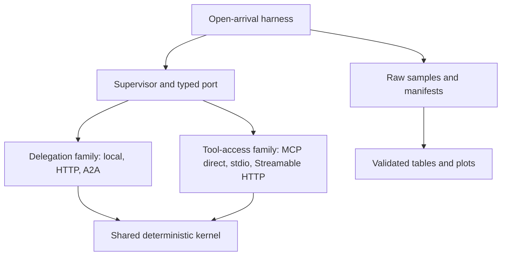

# Agent Boundary Bench

[](https://github.com/brunovicco/agent-boundary-bench/actions/workflows/quality.yml)
[](docs/RELEASE_0.2.0.md)
[](pyproject.toml)
[](LICENSE)

A reproducible laboratory asking: **what changes when the same operation crosses a process and protocol boundary?** Synthetic corporate credit analysis runs through delegation boundaries (in-process Python, conventional HTTP and A2A JSON-RPC) and separate MCP tool-access boundaries (SDK direct dispatch, stdio and Streamable HTTP). No LLM, commercial key, database or real financial data is used.

[Português](README.pt-BR.md) · [v0.2.0 release notes](docs/RELEASE_0.2.0.md) · [v0.3 development](docs/RESILIENCE.md) · [Methodology](docs/METHODOLOGY.md) · [Compatibility research](docs/COMPATIBILITY.md) · [Validation](VALIDATION.md)

**Current release: v0.2.0.** It extends the v0.1 delegation laboratory with official MCP Python SDK v2 tools/resources, bounded generalized fan-out/fan-in and controlled context/access amplification. See [the release notes](docs/RELEASE_0.2.0.md) for the delivered scope and [the validation record](VALIDATION.md) for exactly what ran. A smoke or pilot result does not establish saturation or a general architecture ranking.

**Active development: `0.3.0.dev0`.** The `feat/v0.3.0` line adds controlled delegation faults,
bounded retries, stable idempotency IDs and service backpressure. This is development scope, not
a published v0.3 release or sustained-failure evidence. See [RESILIENCE.md](docs/RESILIENCE.md).

## The experiment

| Scenario | Delegation | Processes, excluding generator | Persistence |
|---|---|---|---|
| A0 `local` | Typed Python port | Supervisor with embedded specialists | None |
| A1 `http` | JSON over persistent HTTP/1.1 | Supervisor + one specialist worker | None |
| A2 `a2a` | A2A 1.0 JSON-RPC, official SDK | Supervisor + one specialist worker | Immediate Message replies |

MCP is a separate treatment family for tool/resource access:

| Scenario | Tool-access boundary | Processes, excluding generator | MCP transport |
|---|---|---:|---|
| T0 `mcp-inprocess` | Official SDK direct dispatcher | Supervisor with embedded tool server | In-process SDK facility |
| T1 `mcp-stdio` | Official SDK client and child server | Supervisor + one tool worker | JSON-RPC over stdio |
| T2 `mcp-streamable-http` | Official SDK client and remote server | Supervisor + one tool worker | Streamable HTTP |

All three specialists (`document_analyst`, `financial_analyst`, `compliance_analyst`) share one deterministic kernel. Remote services expose three skills in one process, identically for A1/A2. These are synthetic specialist roles, not autonomous LLM agents. No independent trust or scaling benefit is claimed as measured in v0.1.



The diagram shows alternative runs: HTTP and A2A do not share a live worker in a measured native round.

### Why MCP is not a competing agent protocol

A2A delegates work to an independently exposed agent. MCP exposes tools, resources and prompts to a host. Ordinary HTTP is the service communication baseline. Comparing A2A and MCP latencies as if they represented interchangeable responsibilities would answer the wrong question. v0.2 implements MCP as its own treatment family and retains explicit scenario/configuration labels rather than declaring one protocol a replacement for another.

### Hypotheses, not conclusions

1. Boundary overhead can represent a larger fraction of a minimal workload than of a delayed workload.
2. Larger bodies and more delegations can amplify serialization and transport costs.
3. Concurrent delegation may reduce elapsed wait while increasing in-flight demand.
4. Instrumentation/export settings can measurably affect latency and resources.
5. Retry can recover availability while duplicating work unless the delegated operation has an
   explicit idempotency strategy.

These require matched conditions and repetitions. An artificial async wait models waiting, not CPU work or LLM inference.

## Quick start

Requirements: Python 3.12–3.14 and uv 0.13.4 or compatible. The release was validated with Python 3.12.14 on Linux and 3.12.13 on macOS. Installation needs network access; basic experiments work offline after dependencies are cached/installed.

```bash
uv sync --frozen --all-groups
uv run abb validate
uv run python scripts/quality_gate.py
uv run abb run --scenario local --profile smoke
uv run abb run --scenario http --profile smoke
uv run abb run --scenario a2a --profile smoke
uv run abb run --scenario mcp-inprocess --profile smoke
uv run abb run --scenario mcp-stdio --profile smoke
uv run abb run --scenario mcp-streamable-http --profile smoke
uv run abb report --input results/ --output reports/latest
```

`run` owns and cleans up the remote specialist subprocess automatically; local needs no external service. Run from the repository root so fixtures and `uv.lock` are available. Do not compare runs while tests or other benchmarks compete for the same host.

```bash
uv run abb run --scenario a2a --payload-bytes 131072 --wait-ms 50 \
  --parallel --telemetry --rate 20 --duration 10 --output results/example
uv run abb campaign --config experiments/pilot.json --output results/pilot
uv run abb campaign --config experiments/full.json --output results/full
uv run abb campaign --config experiments/mcp-pilot.json --output results/mcp-pilot
uv run abb campaign --config experiments/mcp-full.json --output results/mcp-full
uv run abb campaign --config experiments/mcp-amplification-full.json \
  --output results/mcp-amplification
uv run abb campaign --config experiments/resilience-smoke.json \
  --output results/resilience-smoke
uv run abb campaign --config experiments/timeout-smoke.json \
  --output results/timeout-smoke
uv run abb campaign --config experiments/backpressure-smoke.json \
  --output results/backpressure-smoke
uv run abb report --input results/full --output reports/full
```

Both delegation `full.json` and boundary-focused `mcp-full.json` have **1,620 rounds** and 13.5 hours of measurement windows. `mcp-amplification-full.json` has 1,440 rounds and factors payload, context copies, repeated tool/resource access and fan-out separately from capacity rates. Start with `mcp-smoke.json` or the five-repeat MCP pilot. Startup and warmup add time; do not execute two campaigns concurrently on the same benchmark host.

Example amplification run:

```bash
uv run abb run --scenario mcp-streamable-http --payload-bytes 16384 \
  --context-copies 4 --tool-repetitions 2 --resource-reads 2 \
  --specialist-repetitions 4 --parallel --fanout-limit 8 \
  --rate 20 --duration 10 --output results/mcp-example
```

Example v0.3 development recovery treatment:

```bash
uv run abb run --scenario a2a --profile smoke \
  --fault-mode after-commit --max-attempts 2 --attempt-timeout 1 \
  --idempotency --output results/v030-a2a-after-commit
```

The unchanged business result is insufficient evidence on its own: inspect `attempts`, `retries`,
`kernel_executions`, `idempotency_hits`, `injected_failures`, `rejections` and
`backpressure_wait_ms` in schema v3 raw data and reports.

Campaign order is shuffled independently within each repetition using an explicit seed. `campaign.json` stores the planned order and completed rounds. Use a new output directory for each campaign. Failed warmup/startup aborts visibly; incomplete round directories lack a completed manifest and must not be treated as results.

## Containers and health

```bash
docker compose up --build --wait
uv run abb health --url http://127.0.0.1:8101
uv run abb health --url http://127.0.0.1:8102
uv run abb health --url http://127.0.0.1:8103
docker compose --profile tools run --rm verify
docker compose images --format json > results/container-images.json
docker compose down --remove-orphans
```

HTTP, A2A and MCP Streamable HTTP use the same image, one worker, 1 CPU and 512 MiB limits. A2A advertises `http://a2a:8100/rpc` inside Compose; MCP is available at `http://mcp:8100/mcp`. `verify` executes all three public protocol clients and compares their business results. Compose build, health and equivalence checks were validated on macOS; GitHub Actions executes the same functional topology without publishing runner timings. Native `abb run` intentionally uses native subprocesses, not these containers; never relabel a native result as a Docker measurement. Save actual built image IDs before any separately designed container campaign.

## Independent k6 generator

Install k6 (2.3.0 was validated). An automatic smoke wrapper is also available: `uv run python scripts/k6_smoke.py --scenario a2a --output results/k6-a2a`. It captures raw output, summary, versions and environment. For manual control, in terminal 1:

```bash
uv run abb gateway --scenario a2a --port 8200 --output results/k6-gateway
```

In terminal 2:

```bash
mkdir -p results/k6
ABB_RATE=20 ABB_DURATION=10s k6 run --out json=results/k6/raw.jsonl \
  --summary-export results/k6/summary.json k6/arrival.js
```

Stop terminal 1 with Ctrl-C. Repeat for any of the six scenarios. k6 uses `constant-arrival-rate`, fixed preallocated VUs, three warmup requests and explicit dropped-iteration/error thresholds. Custom `abb_measured_*` metrics exclude setup; built-in HTTP metrics include warmup. The extra supervisor HTTP ingress is common to all k6 scenarios. **Keep k6 and native latencies separate.** k6's own JSON/summary are supplemental generator validation, not inputs to `abb report`. Native manifests are the canonical v0.2 measurement schema; committed v0.1 records remain readable. Full container/k6 resource campaigns require their own environment records.

## Data and interpretation

Each completed round contains `manifest.json`, `samples.jsonl`, `resources.jsonl`, and spans when enabled. Reports verify schemas, counts, contiguous sample IDs and file hashes before calculating P50/P95/P99, mean, median, throughput, failures, timeouts, body bytes, calls, retry/idempotency/admission counters, CPU seconds and sampled peak RSS. `telemetry-deltas.csv` contains unique matched on/off pairs; `span-summary.csv` excludes warmup through measured trace IDs. Percentiles describe successful offered-arrival-to-completion latency, including scheduler lag. Errors/drops/rejections are reported separately. See [schemas and definitions](docs/RESULTS_SCHEMA.md).

`0` bytes/calls means no boundary activity for local success; `null` means unmeasured or unavailable, especially partial failed executions. HTTP/A2A byte fields are observed HTTP bodies. MCP byte fields are explicit tool arguments, text results and resource URI/content; they exclude JSON-RPC/HTTP framing. `context_bytes`, `tool_calls` and `resource_reads` expose amplification directly. The manifest records this scope, so unlike byte definitions must not be silently pooled. No subtraction of means is presented as a causal network decomposition.

Telemetry uses public OTel APIs, explicit always-on sampling, W3C trace context through HTTP headers or MCP request metadata, and metadata-only JSONL export. Enabled-mode cost includes synchronous export. The kernel has no SDK dependency. `a2a-otel-kit` remains an optional separate treatment rather than changing the A2A baseline implicitly.

## Architectural Decision Insights

[Recorded insights](reports/INSIGHTS.md) include 246 native rounds and 4,092 successful executions,
plus separate k6 validation. The repeated delegation pilot observed median per-round P50s of
1.150 ms (local), 12.125 ms (HTTP) and 20.218 ms (A2A), telemetry off, 1 KiB, 20 RPS.
These are five round medians per architecture, not portable or pooled percentiles. An A2A outlier
and variable telemetry deltas are preserved. The short 50 RPS calibration does not establish saturation.

The separate MCP pilot completed 1,200/1,200 requests. In the telemetry-off/no-context-copy/
no-resource-read condition, median round P50 was 3.110 ms for direct dispatch, 5.842 ms for stdio and 6.315 ms
for Streamable HTTP (five rounds, 50 samples per boundary). Adding two uncached resource reads
per specialist increased all three observed medians. These short shared-host results validate
the experiment path; they are not sustained-capacity or protocol-substitutability claims.

- A modular monolith can avoid serialization/process boundaries; this alone says nothing about organizational autonomy or fault containment requirements.
- A service boundary introduces operational components and failure modes. One-host latency does not quantify isolation, independent deployment or cross-region behavior.
- A2A can standardize agent interfaces and discovery. This experiment uses immediate replies; it does not price durable tasks or streaming.
- Hybrid designs can keep frequent internal calls local while exposing selected capabilities remotely. Use measured latency budgets and actual interoperability requirements to choose the boundary.

Use [real recorded evidence](VALIDATION.md) within its limits. General conclusions require isolated capacity sweeps, longer windows, repetitions and fault/resource experiments.

## Repository and contribution

`domain/` owns rules and fixtures; `application/` owns orchestration and ports; `adapters/` owns transport translation; `benchmark/`, `observability/` and `reporting/` own experiment mechanics. `entrypoints/` composes them. Architecture checks enforce inward dependency direction.

Generated from [codex-python-engineering-harness](https://github.com/brunovicco/codex-python-engineering-harness), service profile, with exact provenance in [HARNESS.md](docs/HARNESS.md). [ADRs](docs/adr/) explain design trade-offs. See [CONTRIBUTING.md](CONTRIBUTING.md), [SECURITY.md](SECURITY.md), [ROADMAP.md](docs/ROADMAP.md), the [v0.2.0 release notes](docs/RELEASE_0.2.0.md) and [v0.3 development scope](docs/RESILIENCE.md). CI runs functional checks and never publishes shared-runner timings as comparable benchmarks.

The canonical public repository is [brunovicco/agent-boundary-bench](https://github.com/brunovicco/agent-boundary-bench). Recovery bundles are export artifacts only and are not configured as the normal Git remote.
